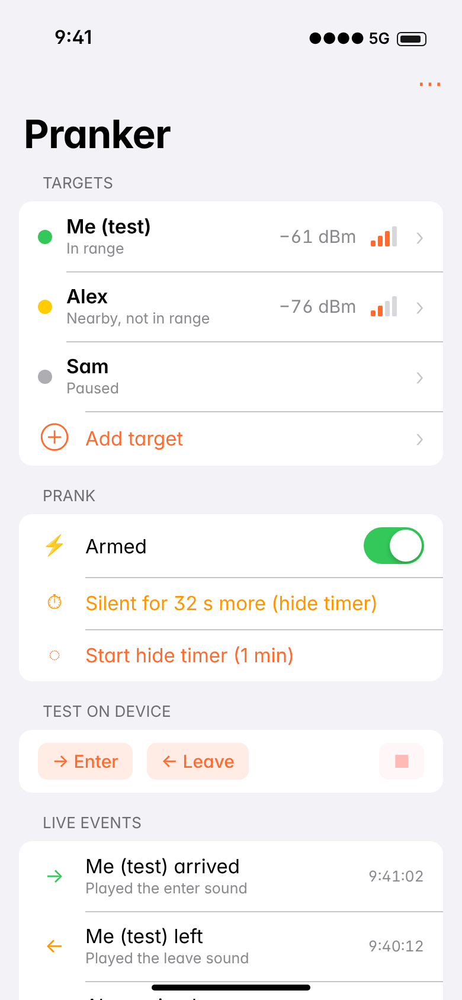
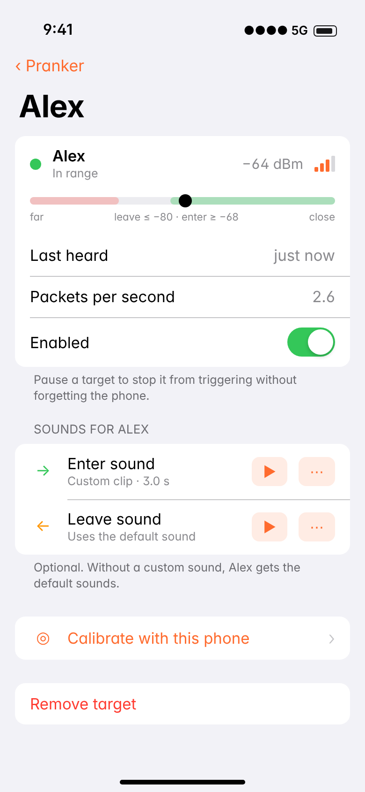
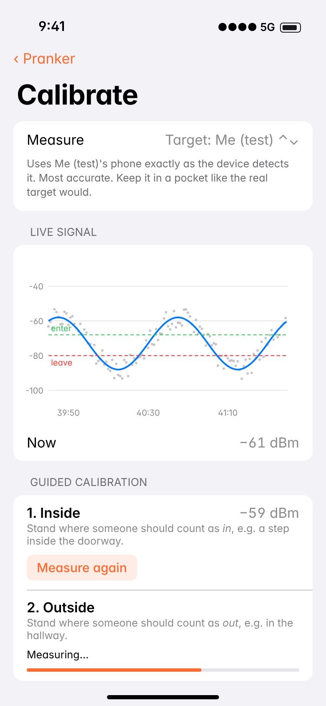
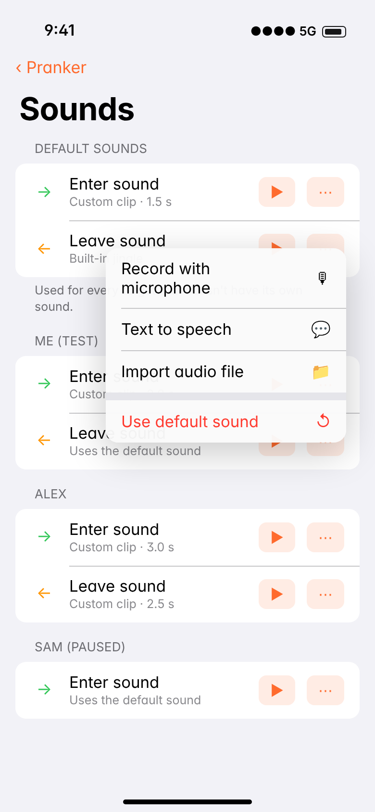

# Bluetooth Pranker

A tiny hidden speaker that plays a sound when one of up to eight enrolled
iPhones comes into range or leaves. It runs on an **M5Stack Atom Echo** (ESP32 + speaker in a
24 mm cube) and comes with an **iOS companion app** for setup, calibration and
custom sounds.

```
firmware/   ESP32 firmware (PlatformIO, Arduino framework)
ios/        SwiftUI companion app (Xcode 16+, iOS 17+)
docs/       BLE protocol between the two, and UI mockups
```

<p>




</p>

*(These are mockups drawn to match the SwiftUI layouts. To see the real app
without hardware, run it in the iOS Simulator and tap **Try demo mode**.)*

## How it works

iPhones change their Bluetooth address every ~15 minutes, but every address is
derived from the phone's **Identity Resolving Key (IRK)**. A phone hands its IRK
to devices it pairs with. So:

1. **Enrollment (once per phone).** The Atom pretends to be a Bluetooth
   keyboard. You pair the target iPhone with it from *Settings › Bluetooth*,
   and it stores the IRK under a name you choose. It holds up to 8 targets.
   Then it reboots with a different address, so the iPhone never reconnects.
   You can then *Forget This Device* on the iPhone.
2. **Normal mode.** The Atom passively listens to Bluetooth advertisements. It
   recognizes each target iPhone by checking addresses against the stored IRKs,
   then tracks each one's signal strength (RSSI) separately.
3. **Presence.** A smoothed RSSI above the *enter* threshold means "arrived".
   Below the *leave* threshold for a few seconds, or not heard at all for a
   while, means "left". The gap between the two thresholds stops it from
   flip-flopping at the doorway.
4. **Prank.** On arrive/leave it plays that target's own sound if it has one,
   otherwise the default sound. Separate *random chance* settings for arrivals
   and departures (e.g. 50% or 20%) make it play only some of the time. Hide timer, cooldown and random
   chance settings keep it unpredictable and give you time to hide it.

## What you need

- M5Stack Atom Echo
- A USB-C power bank. Prefer one with an "always on" or low-current mode,
  since some banks switch off when the load is small. Runtime is roughly
  1–2 days on 5,000 mAh.
- A Mac with Xcode 16 or later, and your Apple developer account

## Flash the firmware

Install [PlatformIO](https://platformio.org/install/cli) (or the VS Code
extension), plug in the Atom Echo, then:

```sh
cd firmware
pio run -t upload        # build + flash
pio device monitor       # optional: serial log at 115200 baud
```

Normal boot: the LED flashes white once, then blinks yellow every 3 s until a
target phone is enrolled. Pressing the button plays the "enter" sound.

## Build the app

Open `ios/BluetoothPranker.xcodeproj`. Under *Signing & Capabilities*, pick
your Team and change the bundle identifier (`com.example.BluetoothPranker`) to
something of yours. Then run it on your iPhone.

The iOS Simulator has no Bluetooth, but **demo mode** (button on the scanner
screen, or launch argument `-demo`) simulates a device with a few targets so
you can click through every screen and take real screenshots.

## Setup walkthrough

1. Open the app and tap your device to connect. The app remembers it and
   reconnects automatically from then on.
2. **Add yourself as a test target first.** *Targets › Add target*, name it
   "Me (test)", tap *Start pairing*. The Atom's LED pulses blue. On your
   iPhone, go to *Settings › Bluetooth*, tap the device under *Other Devices*,
   then *Pair*. Green means success. Then tap ⓘ › *Forget This Device*.
3. **Calibrate range.** Choose *Target: Me (test)* and measure once just inside
   the room and once just outside, phone in a pocket. Tap *Use these values*.
4. **Walk test.** Walk in and out with your phone. You'll hear the sounds, and
   with the app open you get a haptic tap and a live event for each one. For
   a realistic test, also try it with the phone locked in a pocket (see below).
5. **Sounds.** Set default sounds and, optionally, per-target ones: record
   your own, type text-to-speech, or import any audio file. Clips are
   converted on the phone to 16 kHz mono WAV, trimmed and normalized, then
   uploaded over Bluetooth.
6. **Add the real target** the same way, using their phone. Pause or remove
   "Me (test)" so you don't set it off yourself.
7. **Hide it.** Tap *Start hide timer* (default 60 s of silence), stash the
   device and walk away. The event log shows what happened.

### Testing with your own phone

- **The app's connection doesn't interfere.** Detection uses the phone's
  regular Bluetooth broadcasts, which an iPhone keeps sending while connected
  to the app. Each target is matched by its own key, so your phone being both
  "the app" and "a target" is fine.
- **An unlocked phone in your hand is easier to detect than a locked one in a
  pocket.** It broadcasts more often, and your hand blocks less signal than a
  body. So arrivals and departures can look quicker in testing than they'll be
  for real. Do at least one walk with your phone locked in a pocket, then
  check the event log.
- *This phone (app connection)* in Calibrate measures the app's own link
  instead, so you can calibrate without enrolling anything. It's close to how
  the device hears a target, typically within a few dB.

## Device controls

| Action | Result |
|---|---|
| Short press | Play the default "enter" sound |
| Hold 3 s | Enrollment mode for a new target named "Target" (rename it in the app) |
| Press during enrollment | Cancel |

| LED | Meaning |
|---|---|
| White flash | Booted |
| Yellow blink every 3 s | No (enabled) target phones yet |
| Pulsing blue | Enrollment: waiting for the iPhone to pair |
| Green / red (2 s) | Enrollment succeeded / failed |
| Off | Normal (stealth). Turn on "Show presence on LED" in Settings to debug. |

## Tuning notes

- **Leaving is slower than arriving.** Locked iPhones advertise less often,
  so "left" waits for a weak signal lasting *Weak signal must last*, or for
  *Gone after silence*. If you get false "left" events while he's still in
  the room, raise *Gone after silence*.
- **Walls help.** A doorway with a wall between the rooms gives a much
  sharper in/out difference than an open floor plan.
- **Placement.** Put the device on the "inside" side of the room, not next
  to the door, and not inside a closed metal or wooden box.
- If a target isn't heard at all, re-enroll it (this keeps its sounds; the
  same phone is recognized and just renamed). *Reset Network Settings* on a
  phone creates a new IRK.
- Thresholds are shared by all targets. Different iPhone models read within a
  few dB of each other, so calibrating with one phone is usually fine.

## Status

- **Firmware** compiles cleanly (PlatformIO, espressif32 8.0.0, NimBLE-Arduino
  2.5.2), flashes and boots on a real Atom Echo. The address-resolution code
  is checked against the Bluetooth spec's test vector at every boot.
- **iOS app** builds cleanly with Xcode 27 and runs in the Simulator in demo
  mode. It hasn't run on a real iPhone yet.
- **End to end:** enrollment, detection and upload haven't been tested on
  real hardware yet.

See `CLAUDE.md` for the design notes, known risks and test checklist.
